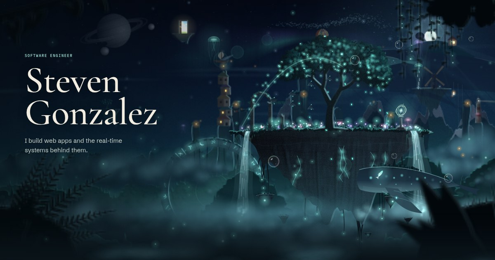

# Steven Gonzalez Portfolio

Source for the portfolio and writing site of Steven Gonzalez, a software engineer.

[](https://stevengonzalez.dev)

Live site: [stevengonzalez.dev](https://stevengonzalez.dev)

## Overview

The site is built with Next.js, TypeScript and MDX. It has case studies of my projects, articles on how I built things, and a small painted world at the top of the home page: floating sky islands drawn live with Canvas 2D, with no images or libraries.

## What You Will Find Here

- A homepage hero that paints living sky islands in layered canvases, with the drawing done in Web Workers
- Project case studies covering mobile, SaaS, desktop, and platform engineering work
- A Writing section for longer pieces on the graphics and sound behind this site, architecture, delivery, and engineering tradeoffs
- Data-driven content structures for projects and writing

## Checks

GitHub Actions runs these on every push to main and every pull request:

- `yarn validate` - lint, formatting, types, and the content and theme checks
- `yarn audit` of the production dependencies, which also runs weekly
- `yarn check:speed` - loads the home page and a case study in Lighthouse as a phone would, and fails if largest
  contentful paint goes over 3.5 s or layout shift over 0.02
- `yarn test:site` - in Chrome at desktop and phone sizes, every page loads without errors and passes an accessibility
  scan in both themes, and the main paths work
- `yarn test:engines` - the same browser tests in Firefox and WebKit

On a push to main that touches `lib/world`, it also runs `yarn check:world` against the previous push. That check draws
1,500 frames of the world in a browser at each revision and compares the canvases pixel by pixel, so a refactor of the
renderer has to draw exactly what it drew before. A commit that is meant to change the picture says so with a
`World-change:` line in its message.

## Stack

- Next.js 16
- React 19
- TypeScript
- MDX
- Yarn

## Local Development

```bash
yarn
yarn dev
```

Open `http://localhost:3000`.

## Scripts

- `yarn dev` - start the local dev server
- `yarn build` - create a production build
- `yarn start` - run the production build locally
- `yarn lint` - run ESLint
- `yarn format` - format the code with Prettier
- `yarn format:check` - check that the code is formatted, without changing it
- `yarn type-check` - run TypeScript checks, on the app and on the world's JavaScript
- `yarn validate:content` - validate project and insight content
- `yarn validate:theme` - check that the theme's colour tokens agree
- `yarn validate` - run lint, the format check, type-check, and the content and theme checks
- `yarn bench:world` - time the world's frames in headless Firefox against a git revision
- `yarn check:world` - check that the world draws exactly what a git revision drew, canvas by canvas
- `yarn check:sound` - check that the world's sound is exactly what a git revision made, rendered offline
- `yarn check:speed` - load the production build's pages in Lighthouse as a phone would, and check their load speed and
  layout shift against set limits (run `yarn build` first; needs Chrome)
- `yarn test` - run the unit tests of the packages in `packages/`
- `yarn test:site` - run the browser tests against the production build in Chrome, at desktop and phone sizes: every
  page loads without errors and passes an accessibility scan in both themes, and the main paths work (run `yarn build`
  first)
- `yarn test:engines` - run the same browser tests in Firefox and WebKit (run `yarn playwright install firefox webkit`
  once first)

## Packages

- [`packages/frame-pacer`](packages/frame-pacer) - the frame pacing used by the world, on its own and with its own
  tests. It keeps a slow canvas animation on an even rhythm by stepping it every N screen refreshes.

## Content Structure

- `app/` - route-level pages and MDX insight entries
- `components/` - reusable UI and interaction components
- `lib/world/` - the painted world engine behind the homepage hero
- `data/projects.ts` - project case study metadata and long-form content
- `data/insights.ts` - insight metadata
- `scripts/validate-content.mjs` - guards against missing or inconsistent content

## About Me

I work mostly in C# and .NET on the back end, and React, Next.js and TypeScript on the front end. I also build mobile apps with React Native, and use Python, SQL and automation tooling where they fit.

## Connect

- Portfolio: [stevengonzalez.dev](https://stevengonzalez.dev)
- GitHub: [@StevenGonzalez](https://github.com/StevenGonzalez)
- LinkedIn: [sgonzalez-dev](https://www.linkedin.com/in/sgonzalez-dev/)
